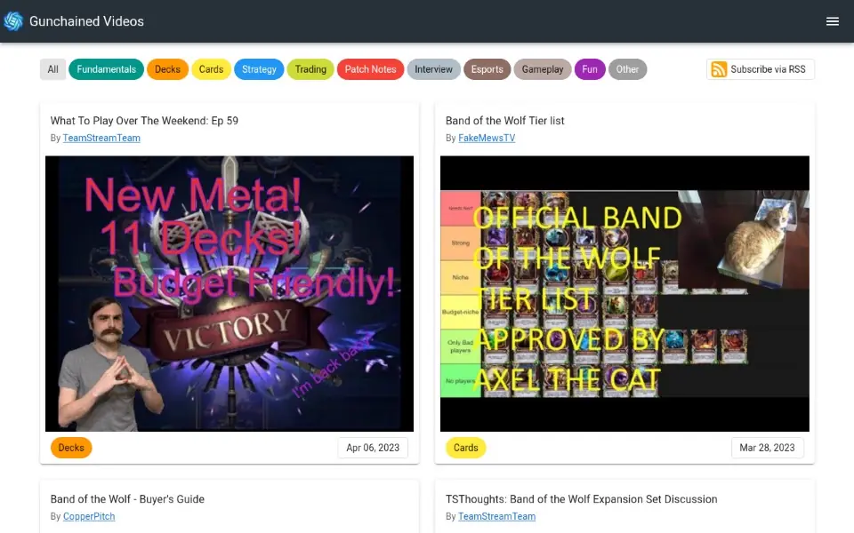

# Gunchained

A curated library of nearly 300 Gods Unchained videos from 16 creators, sorted into categories like Decks and Strategy so players find the good stuff fast.

**[Visit the live site](https://gunchained.soleone.xyz)**



## Features

- Every video as a card with its thumbnail, creator and publish date, newest first.
- One click filters by category (Fundamentals, Decks, Cards, Strategy, Trading, Esports and more) or by creator.
- Each video has its own linkable page with the YouTube player.
- 23 themes in a 3D picker (press T), with Gilt as the default and D to flip between dark and light. The category colors follow the theme.
- An RSS feed of the newest 50 videos at `/feed.xml`.
- The Arena, where signed-in players share their challenge codes to find matches.
- An admin upload page that fills in a video's details from its YouTube link.

The [changelog](CHANGELOG.md) lists what changed and the [roadmap](ROADMAP.md) collects ideas.

## Run it locally

Needs Node 22 and Yarn 1. The app reads the real video library from Firestore, so there is nothing to set up.

```sh
yarn install
yarn serve
```

`yarn serve` and `yarn build` first build the theme picker in `picker/`, a small React app from the [soleone registry](https://github.com/Soleone/shadcn-components) that mounts into the Vue app bar. `yarn build` writes the static site to `dist`.

## How it works

- Vue 2 with Vuetify, Vuex and Vue Router, built with Vue CLI.
- Firebase for sign-in (email, Google, Twitter, GitHub) and Firestore for videos, players and feedback. The web config in `firebase.config.js` is public by design; Firestore rules guard the data.
- A Cloud Function in `functions/` renders the RSS feed.
- Hosted on Vercel at [gunchained.soleone.xyz](https://gunchained.soleone.xyz); `vercel.json` sends `/feed.xml` to the function.
- `yarn media:capture` re-records the demo loop above from the live site with [showcase](https://github.com/Soleone/showcase).

## Contributing

Suggestions and issues are welcome at [github.com/Soleone/gunchained/issues](https://github.com/Soleone/gunchained/issues).
